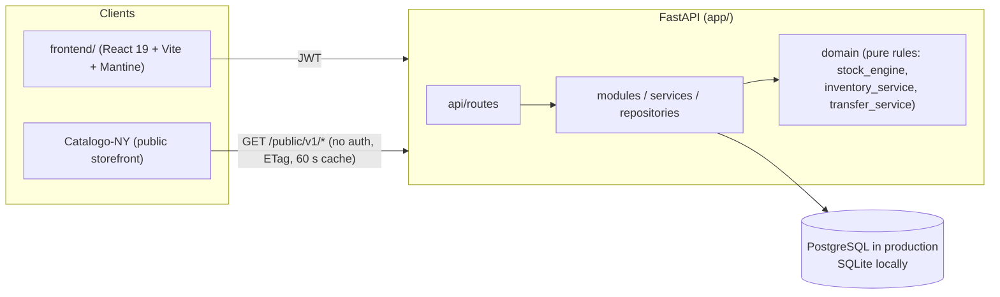

# Architecture

- **Domains and route prefixes:** `/stock`, `/catalog`, `/marketing`, `/reports`, `/admin`, plus `/auth`, `/branches`, `/locations`. `/public/v1` is the only unauthenticated surface.
- **Permissions** follow `domain.resource.action` (`catalog.*`, `stock.*`, `marketing.*`, `auth.*`, `reports.*`, `audit.*`); see [roles-matrix.md](roles-matrix.md).
- **Branch scope:** a user sees only the branches assigned to them (`app/core/branch_scope.py`).
- **Observability and ops:** [observability.md](observability.md), [runbook-database.md](runbook-database.md).
- **Deploy:** Vercel (static frontend + API as a Python function) or Render (`render.yaml`).
